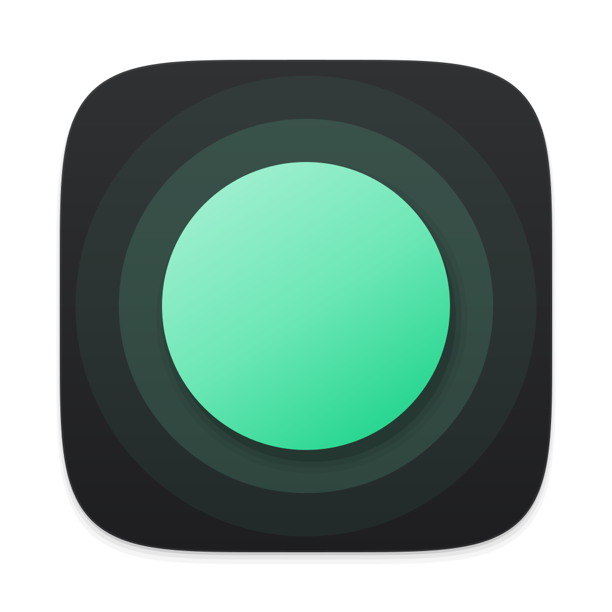
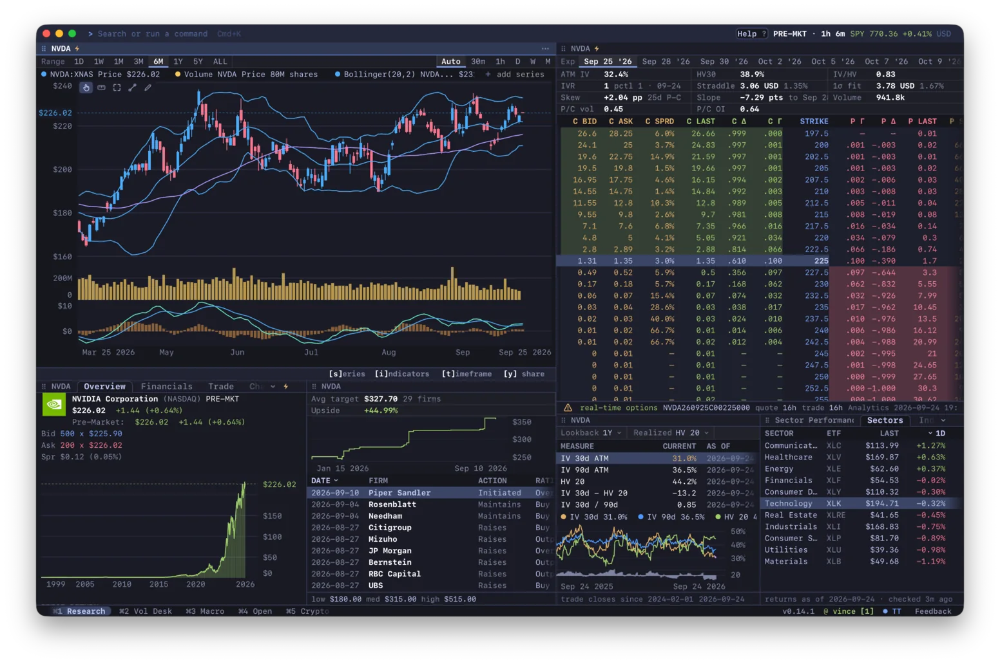
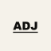

<div align="center">



# Gloom

**オープンソースの金融ターミナル。高速で、キーボードで操作でき、拡張できます。**

<a href="#インストール"><strong>インストール</strong></a>
&nbsp;&middot;&nbsp;
<a href="https://gloom.sh/download/desktop"><strong>デスクトップアプリ</strong></a>
&nbsp;&middot;&nbsp;
<a href="https://term.gloom.sh"><strong>ブラウザーで試す</strong></a>
&nbsp;&middot;&nbsp;
<a href="https://gloom.sh/discord">Discord</a>
&nbsp;&middot;&nbsp;
<a href="README.md">English</a>
&nbsp;&middot;&nbsp;
<a href="README.zh-CN.md">简体中文</a>

<br />
<br />



<sub><a href="https://adjacent.markets/?ref=gloomberb"> Adjacent</a> の支援を受けています</sub>

</div>

株価、チャート、財務情報、開示書類、オプション、ニュース、そしてあなたのポートフォリオを、キーボードで操作する 1 つのワークスペースにまとめています。企業の詳細なら `DES AAPL`、チャートなら `GP NVDA` と入力します。ターミナル（macOS、Linux、Windows）、デスクトップアプリ（macOS、Windows）、ブラウザーで動きます。

## インストール

macOS または Linux：

```bash
curl -fsSL gloom.sh/install | bash
```

Windows では PowerShell で：

```powershell
irm https://gloom.sh/install.ps1 | iex
```

あるいは、どのプラットフォームでも [Bun](https://bun.sh) で：

```bash
bun install -g @gloom-sh/terminal
```

`npm install -g @gloom-sh/terminal` でもインストールできますが、コマンドは Bun で動くので、先に [Bun](https://bun.sh) をインストールしてください。

それから `gloom` を実行します（以前の名前の `gloomberb` も引き続き使えます）。Apple Silicon では、スクリプトがデスクトップアプリの Gloom.app もインストールします。Homebrew、Windows のデスクトップ版インストーラー、手動でのダウンロードについては[インストールガイド](docs/installation.md)にあります。

チャートは、Ghostty、Kitty、WezTerm など Kitty 互換のターミナルでは画像として、それ以外ではテキストとして描画されます。

## はじめる

`Ctrl+P` でコマンドバーを、`` ` `` でティッカーの検索を開きます。`HELP` ですべてのコマンドとショートカットが一覧でき、[機能カタログ](https://gloom.sh/docs/functions)ではそのすべてを見られます。

シェルからは、`gloom quote AAPL` で株価を表示します。スクリプトで使うには `--json` を付けます。チャート、ブローカー、ショートカット、CLI については[ユーザーガイド](docs/usage.md)で説明しています。

## データとプライバシー

無料のマーケットデータは遅延しています：株価は 15 分、ニュースは 12 時間です。Pro ではリアルタイムのデータが使えます。マーケットデータと Ask Gloom は、オープンソースではないホスト型のサービスである [Gloom Cloud](https://gloom.sh/cloud) から提供されます。アプリ自体は MIT ライセンスです。[何がオープンで何がそうでないか](docs/open-source.md)を参照してください。

クラッシュレポートと利用回数の送信はオフにできます：[送信される内容](docs/telemetry.md)。

## プラグインとコントリビューション

プラグインは、ペイン、データソース、ブローカー、コマンドを追加します。`gloom install gloom-sh/gloom-tv` で GitHub からインストールすることも、[プラグインガイド](PLUGINS.md#your-first-pane)で自分で作ることもできます。Gloom 自体の開発に参加するには、`git clone --filter=blob:none https://github.com/gloom-sh/gloomberb.git` でクローンし、[CONTRIBUTING.md](CONTRIBUTING.md) を読んでください。

[MIT ライセンス](LICENSE)。[OpenTUI](https://opentui.com/) で作られています。[Gloom をスポンサーする](https://gloom.sh/sponsor)。
