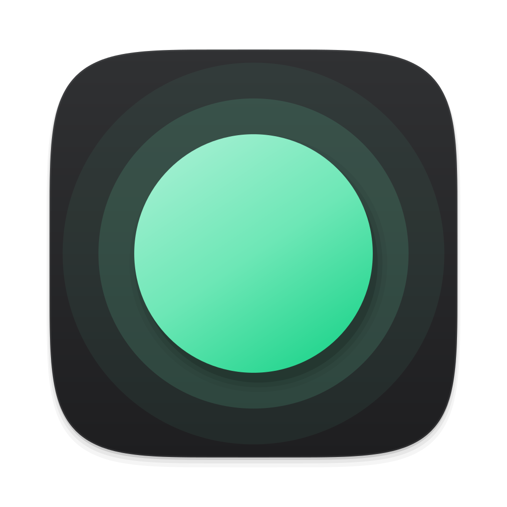
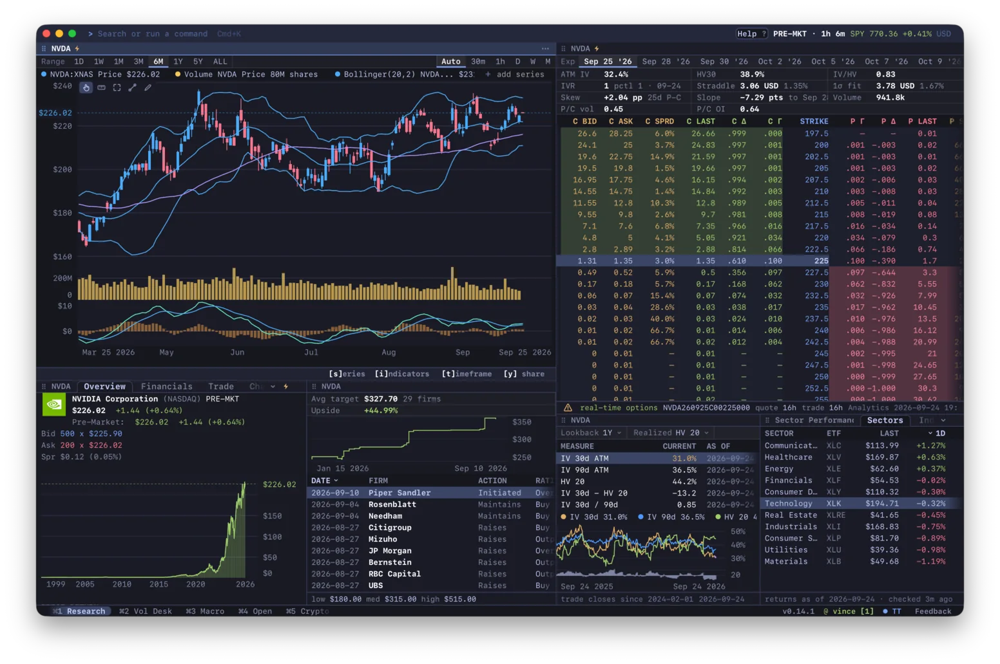
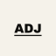

<div align="center">



# Gloom

**Open-source finance terminal. Fast, keyboard-driven, and extensible.**

<a href="#install"><strong>Install</strong></a>
&nbsp;&middot;&nbsp;
<a href="https://gloom.sh/download/desktop"><strong>Desktop app</strong></a>
&nbsp;&middot;&nbsp;
<a href="https://term.gloom.sh"><strong>Try it in the browser</strong></a>
&nbsp;&middot;&nbsp;
<a href="https://gloom.sh/discord">Discord</a>
&nbsp;&middot;&nbsp;
<a href="README.zh-CN.md">简体中文</a>

<br />
<br />



<sub>Backed by <a href="https://adjacent.markets/?ref=gloomberb"> Adjacent</a></sub>

</div>

Quotes, charts, financials, filings, options, news and your portfolio in one workspace you drive from the keyboard. Type `DES AAPL` for company details or `GP NVDA` for a chart. It runs in your terminal (macOS, Linux, Windows), as a desktop app (macOS, Windows), and in the browser.

## Install

macOS or Linux:

```bash
curl -fsSL gloom.sh/install | bash
```

Windows, in PowerShell:

```powershell
irm https://gloom.sh/install.ps1 | iex
```

Or with [Bun](https://bun.sh), on any of them:

```bash
bun install -g @gloom-sh/terminal
```

Then run `gloom` (`gloomberb`, its old name, still works). On Apple Silicon the script also installs the desktop app, Gloom.app. Homebrew, the Windows desktop installer and manual downloads are in the [installation guide](docs/installation.md).

Charts draw as images in Kitty-compatible terminals such as Ghostty, Kitty and WezTerm, and as text elsewhere.

## Start

Press `Ctrl+P` for the command bar, or `` ` `` to search for a ticker. `HELP` lists every command and shortcut, and the [function catalog](https://gloom.sh/docs/functions) shows them all.

From your shell, `gloom quote AAPL` prints a quote; add `--json` for scripts. The [user guide](docs/usage.md) covers charts, brokers, shortcuts and the CLI.

## Data and privacy

Free market data is delayed: quotes by 15 minutes, news by 12 hours. Pro adds real-time data. Market data and Ask Gloom come from [Gloom Cloud](https://gloom.sh/cloud), a hosted service that is not open source; the app itself is MIT licensed. See [what is open and what is not](docs/open-source.md).

Crash reports and usage counts can be turned off: [what is sent](docs/telemetry.md).

## Plugins and contributing

Plugins add panes, data sources, brokers and commands. Install one from GitHub with `gloom install gloom-sh/gloom-tv`, or build your own with the [plugin guide](PLUGINS.md#your-first-pane). To work on Gloom itself, read [CONTRIBUTING.md](CONTRIBUTING.md).

[MIT licensed](LICENSE). Built with [OpenTUI](https://opentui.com/). [Sponsor Gloom](https://gloom.sh/sponsor).
