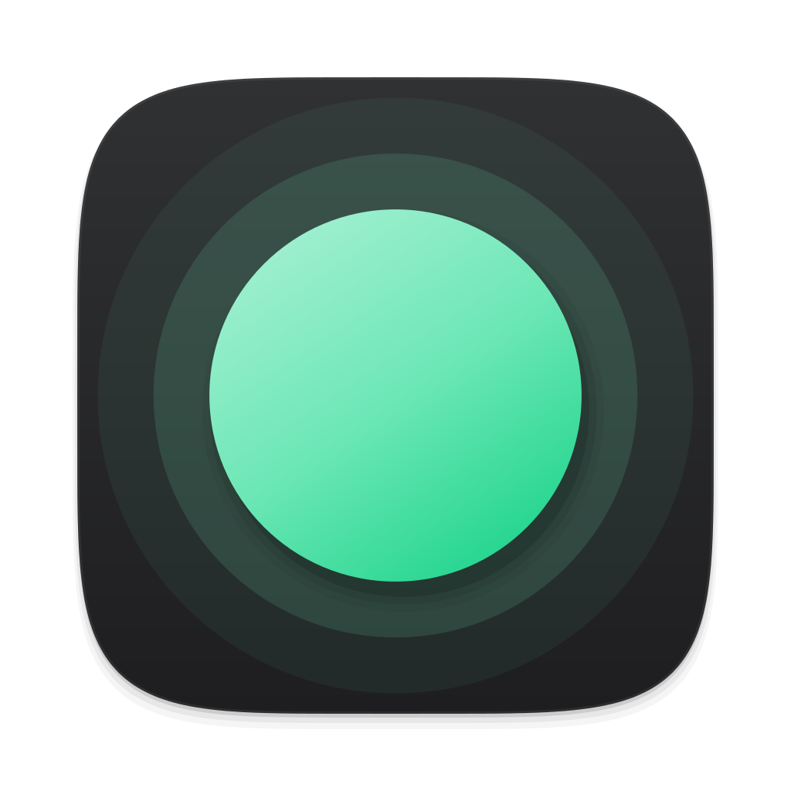
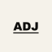

<div align="center">



# Gloom

**Open-source finance terminal. Fast, keyboard-driven, and extensible.**

Desktop app for macOS and Windows. Terminal UI for macOS, Linux, and Windows.

<a href="https://gloom.sh/download/desktop"><strong>Download desktop</strong></a>
&nbsp;&middot;&nbsp;
<a href="#install"><strong>Install the TUI</strong></a>
&nbsp;&middot;&nbsp;
<a href="https://term.gloom.sh"><strong>Open in browser</strong></a>
&nbsp;&middot;&nbsp;
<a href="https://gloom.sh/discord">Discord</a>
&nbsp;&middot;&nbsp;
<a href="README.zh-CN.md">简体中文</a>

<br />
<br />


<sub>Backed by <a href="https://adjacent.markets/?ref=gloomberb"> Adjacent</a></sub>

</div>

Quotes, charts, financials, filings, options, news, portfolios and alerts in one workspace. Browse every function in the [function catalog](https://gloom.sh/docs/functions).

## Install

On **macOS (Apple Silicon)**:

```bash
brew install --cask gloomberb
```

On **Windows 11**, [download the installer](https://github.com/gloom-sh/gloomberb/releases/latest/download/stable-win-x64-GloomberbSetup.exe). It is not code-signed yet, so SmartScreen may ask you to click **More info**, then **Run anyway**.

For the terminal on **macOS or Linux**:

```bash
curl -fsSL gloom.sh/install | bash
```

The script downloads the prebuilt release from GitHub and checks its SHA-256 against the digest GitHub lists. Apple Silicon Macs get the desktop app and the `gloom` command; Linux and Intel Macs get the standalone binary. It asks for `sudo` only if the destination isn't writable. Prefer to download it yourself? See the [installation guide](docs/installation.md).

With [Bun](https://bun.sh), on any supported OS:

```bash
bun install -g gloomberb
```

Then run `gloom`. The command was called `gloomberb` before 0.19, and that name still works. For chart graphics, use a Kitty-compatible terminal such as Ghostty, Kitty, or WezTerm. Windows Terminal draws charts as text; the desktop app draws them in full.

## Start

Press `Ctrl+P` for the command bar, or `` ` `` to search for a ticker. Try `DES AAPL` for company details or `GP NVDA` for a price chart. `HELP` lists commands and shortcuts.

The [user guide](docs/usage.md) covers charts, broker setup, shortcuts, and the CLI (`gloom quote AAPL`).

## Data and privacy

The app is MIT licensed. Market data and Ask Gloom use [Gloom Cloud](https://gloom.sh/cloud), our hosted service, which is not open source. Free market data is delayed 15 minutes; Pro adds real-time data. See [what is open and what is not](docs/open-source.md). The [browser app](https://term.gloom.sh) has a smaller feature set ([limits](docs/browser.md)).

Crash reports and usage counts can be turned off. See [what is sent and how to opt out](docs/telemetry.md).

## Plugins and contributing

Plugins add panes, data providers, broker connections, and commands. Install one from GitHub with `gloom install gloom-sh/gloom-tv`. See the [plugin guide](PLUGINS.md) and the [contributing guide](CONTRIBUTING.md).

[MIT licensed](LICENSE). Built with [OpenTUI](https://opentui.com/). [Sponsor Gloom](https://gloom.sh/sponsor).
