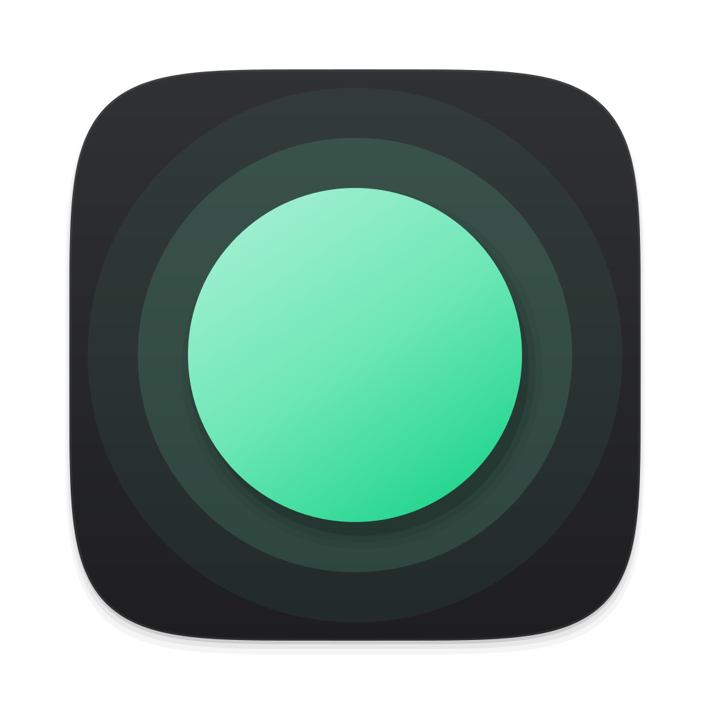
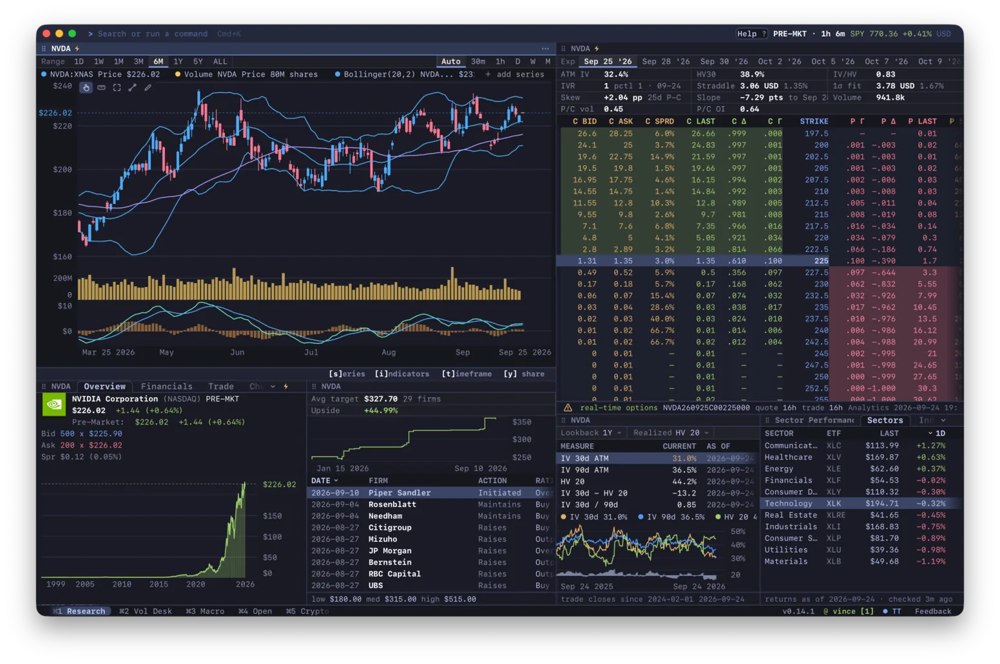
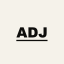

<div align="center">



# Gloom

**Açık kaynaklı finans terminali. Hızlı, klavye odaklı ve genişletilebilir.**

<a href="#kurulum"><strong>Kurulum</strong></a>
&nbsp;&middot;&nbsp;
<a href="https://gloom.sh/download/desktop"><strong>Masaüstü uygulaması</strong></a>
&nbsp;&middot;&nbsp;
<a href="https://term.gloom.sh"><strong>Tarayıcıda dene</strong></a>
&nbsp;&middot;&nbsp;
<a href="https://gloom.sh/discord">Discord</a>
&nbsp;&middot;&nbsp;
<a href="README.md">English</a>
&nbsp;&middot;&nbsp;
<a href="README.zh-CN.md">简体中文</a>
&nbsp;&middot;&nbsp;
<a href="README.ja.md">日本語</a>

<br />
<br />



<sub><a href="https://adjacent.markets/?ref=gloomberb"> Adjacent</a> tarafından desteklenmektedir</sub>

</div>

Fiyatlar, grafikler, finansallar, yasal bildirimler, opsiyonlar, haberler ve portföyünüz; hepsi klavyeden yönettiğiniz tek bir çalışma alanında. Şirket detayları için `DES AAPL` veya grafik için `GP NVDA` yazın. Terminalinizde (macOS, Linux, Windows), masaüstü uygulaması olarak (macOS, Windows) ve tarayıcıda çalışır.

## Kurulum

macOS veya Linux:

```bash
curl -fsSL gloom.sh/install | bash
```

Windows, PowerShell içinde:

```powershell
irm https://gloom.sh/install.ps1 | iex
```

Veya herhangi birinde [Bun](https://bun.sh) ile:

```bash
bun install -g @gloom-sh/terminal
```

`npm install -g @gloom-sh/terminal` da çalışır, ancak komut Bun üzerinde çalıştığı için önce [Bun](https://bun.sh) kurun.

Ardından `gloom` komutunu çalıştırın (eski adı olan `gloomberb` de hâlâ çalışır). Apple Silicon üzerinde betik, masaüstü uygulaması Gloom.app'i de kurar. Homebrew, Windows masaüstü yükleyicisi ve manuel indirmeler [kurulum kılavuzunda](docs/installation.md) yer almaktadır.

Grafikler Ghostty, Kitty ve WezTerm gibi Kitty uyumlu terminallerde görsel olarak, diğerlerinde ise metin olarak çizilir.

## Başlangıç

Komut çubuğu için `Ctrl+P` tuşlarına veya bir hisse senedi kodu aramak için `` ` `` tuşuna basın. `HELP` tüm komutları ve kısayolları listeler; [işlev kataloğu](https://gloom.sh/docs/functions) ise hepsini gösterir.

Kabuğunuzdan `gloom quote AAPL` komutu bir fiyat teklifi yazdırır; betikler için `--json` ekleyin. [Kullanıcı kılavuzu](docs/usage.md) grafikleri, kısayolları, CLI'ı ve aracı kurumlarınızı SnapTrade ile bağlamayı kapsar.

## Veri ve gizlilik

Ücretsiz piyasa verileri gecikmelidir: fiyatlar 15 dakika, haberler 12 saat. Pro sürümü gerçek zamanlı veri ekler. Piyasa verileri ve Ask Gloom, açık kaynak olmayan barındırılan bir hizmet olan [Gloom Cloud](https://gloom.sh/cloud) üzerinden sağlanır; uygulamanın kendisi MIT lisanslıdır. Bkz. [neler açık kaynak, neler değil](docs/open-source.md).

Çökme raporları ve kullanım sayımları kapatılabilir: [neler gönderilir](docs/telemetry.md).

## Eklentiler ve katkıda bulunma

Eklentiler yeni paneller, veri kaynakları, aracı kurumlar ve komutlar ekler. GitHub'dan bir eklentiyi `gloom install gloom-sh/gloom-tv` ile kurabilir veya [eklenti kılavuzu](PLUGINS.md#your-first-pane) ile kendinizinkini oluşturabilirsiniz. Gloom'un kendisi üzerinde çalışmak için `git clone --filter=blob:none https://github.com/gloom-sh/gloomberb.git` ile klonlayın ve [CONTRIBUTING.md](CONTRIBUTING.md) dosyasını okuyun.

[MIT lisanslıdır](LICENSE). [OpenTUI](https://opentui.com/) ile oluşturulmuştur. [Gloom'a Sponsor Olun](https://gloom.sh/sponsor).
