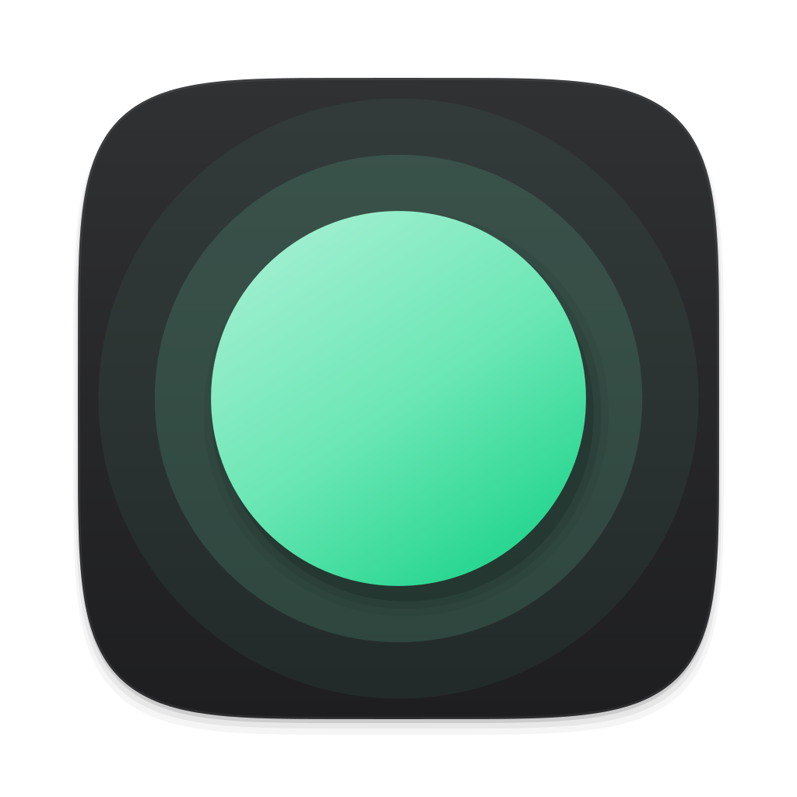
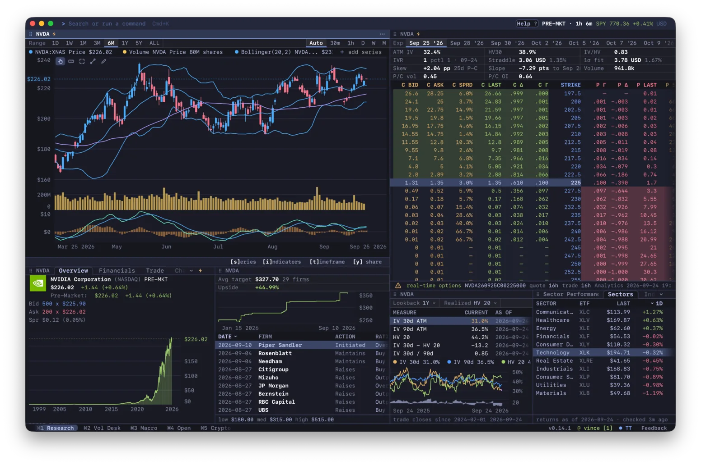
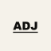

<div align="center">



# Gloom

**开源金融终端。快速、键盘驱动、可扩展。**

<a href="#安装"><strong>安装</strong></a>
&nbsp;&middot;&nbsp;
<a href="https://gloom.sh/download/desktop"><strong>桌面版</strong></a>
&nbsp;&middot;&nbsp;
<a href="https://term.gloom.sh"><strong>在浏览器中试用</strong></a>
&nbsp;&middot;&nbsp;
<a href="https://gloom.sh/discord">Discord</a>
&nbsp;&middot;&nbsp;
<a href="README.md">English</a>

<br />
<br />



<sub>由 <a href="https://adjacent.markets/?ref=gloomberb"> Adjacent</a> 赞助支持</sub>

</div>

> 本文档为社区维护的简体中文翻译。若与 [英文原版 README](README.md) 有出入，以英文版为准。

行情、图表、财务报表、监管文件、期权、新闻和你的投资组合，都在一个用键盘操作的工作区里。输入 `DES AAPL` 查看公司详情，输入 `GP NVDA` 查看价格图表。Gloom 可在终端（macOS、Linux、Windows）、桌面应用（macOS、Windows）和浏览器中运行。

## 安装

macOS 或 Linux：

```bash
curl -fsSL gloom.sh/install | bash
```

Windows，在 PowerShell 中：

```powershell
irm https://gloom.sh/install.ps1 | iex
```

也可在上述任一系统上通过 [Bun](https://bun.sh) 安装：

```bash
bun install -g @gloom-sh/terminal
```

然后运行 `gloom`（旧名称 `gloomberb` 仍可使用）。在 Apple Silicon Mac 上，脚本还会安装桌面应用 Gloom.app。Homebrew、Windows 桌面安装程序与手动下载详见[安装指南（英文）](docs/installation.md)。

在兼容 Kitty 图形协议的终端（如 Ghostty、Kitty、WezTerm）中，图表以图像显示；在其他终端中以文本显示。

## 开始使用

按 `Ctrl+P` 打开命令栏，或按 `` ` `` 搜索股票代码。输入 `HELP` 查看所有命令与快捷键，[功能目录（英文）](https://gloom.sh/docs/functions)列出了全部功能。

在 shell 中运行 `gloom quote AAPL` 即可查看报价；脚本可加 `--json`。[使用指南（英文）](docs/usage.md)介绍图表、券商、快捷键与 CLI。

## 数据与隐私

免费行情为延迟数据：报价延迟 15 分钟，新闻延迟 12 小时。Pro 提供实时数据。行情与 Ask Gloom 来自托管服务 [Gloom Cloud](https://gloom.sh/cloud)，该服务不开源；应用本身采用 MIT 许可证。详见[哪些开源、哪些不开源（英文）](docs/open-source.md)。

崩溃报告与使用统计可以关闭：[发送了哪些内容（英文）](docs/telemetry.md)。

## 插件与贡献

插件可添加面板、数据源、券商连接与命令。用 `gloom install gloom-sh/gloom-tv` 从 GitHub 安装插件，或参考[插件开发指南（英文）](PLUGINS.md#your-first-pane)自己编写。参与 Gloom 开发请阅读[贡献指南（英文）](CONTRIBUTING.md)。

采用 [MIT 许可证](LICENSE)。基于 [OpenTUI](https://opentui.com/) 构建。[赞助 Gloom](https://gloom.sh/sponsor)。
