# Dark theme, 640 px

552 paired views, captured at 640 px. Each sheet shows before on the left and after on the right.

## 13F--detail to ADR--tab-events

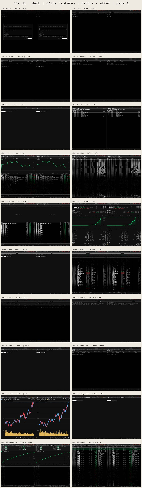

## ADR--tab-exec to APPS--root

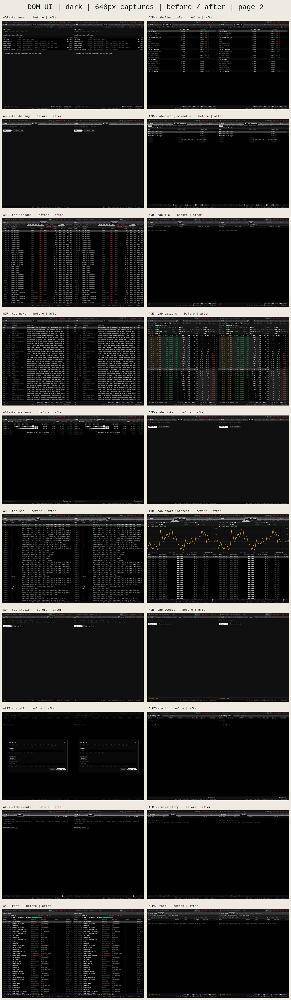

## APPS--tab-chart to AUCT--tab-bonds-2-4

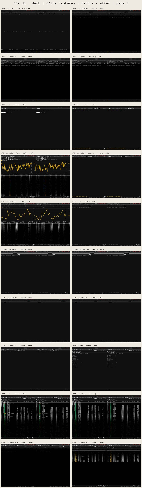

## AUCT--tab-credit to BTST--detail

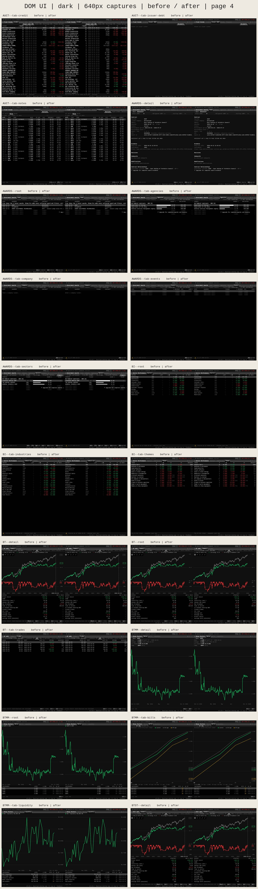

## BTST--root to CAT--tab-rates

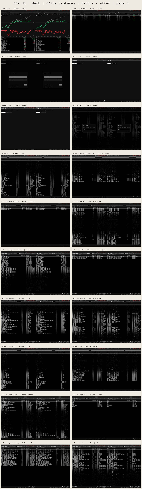

## CAT--tab-securities to CG--detail

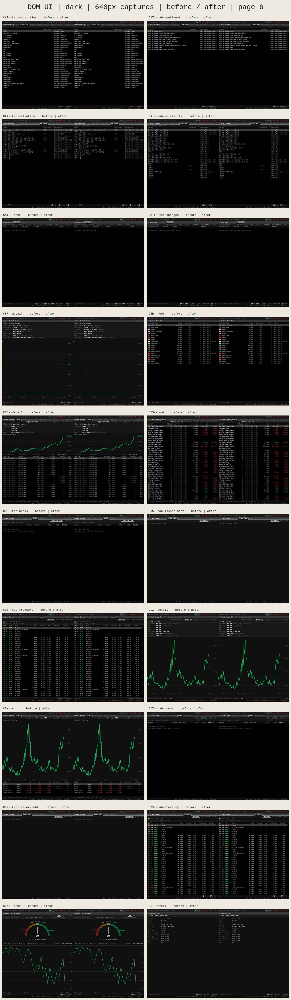

## CG--root to COT--tab-oil-gas

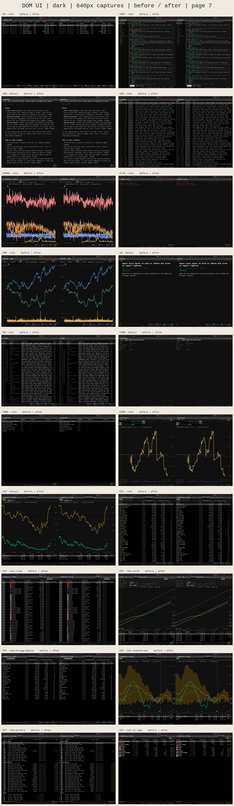

## COVN--root to CRDOC--tab-treasury

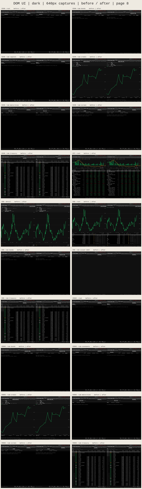

## CRYP--root to DIST--tab-deals

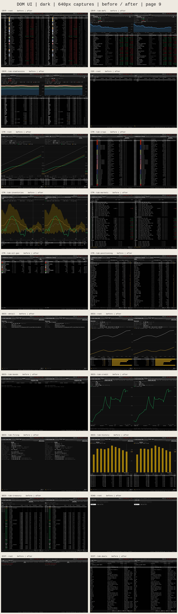

## DOCS--detail to EE--detail

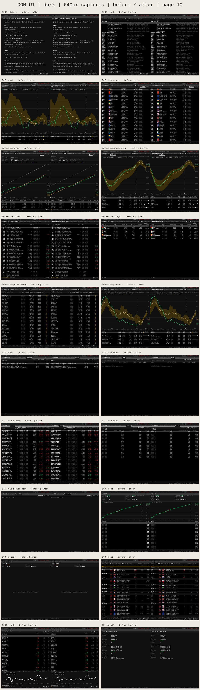

## EE--root to EXEC--root

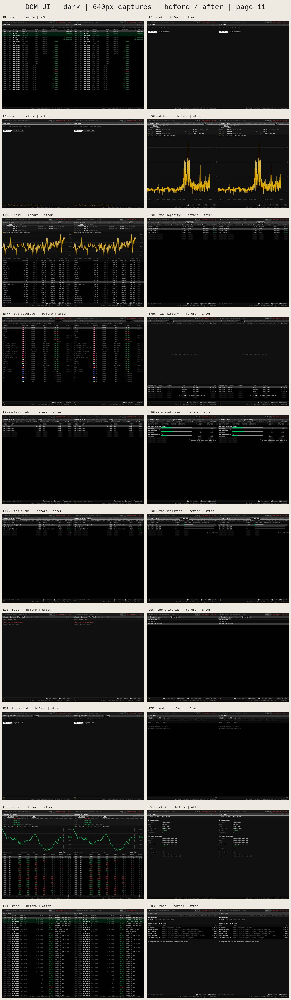

## EXPO--detail to FTD--tab-daily-volume

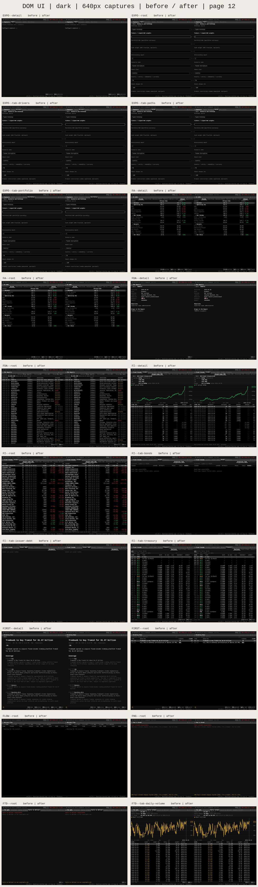

## FTD--tab-interest to GF--root

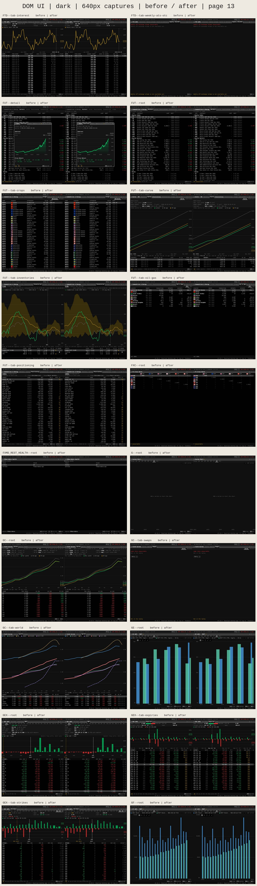

## GIP--root to HALT--root

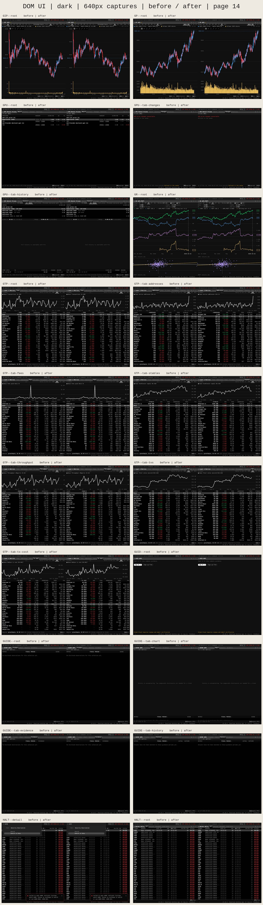

## HALT--tab-active to HIVG--root

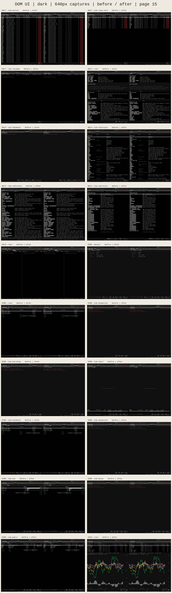

## HM--root to IPO--tab-us

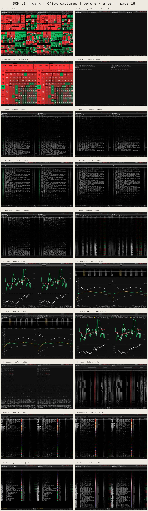

## JOBS--root to LITI--root

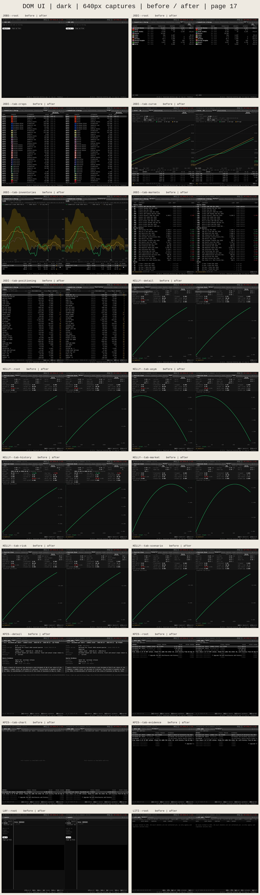

## LITI--tab-changes to NGS--tab-curve

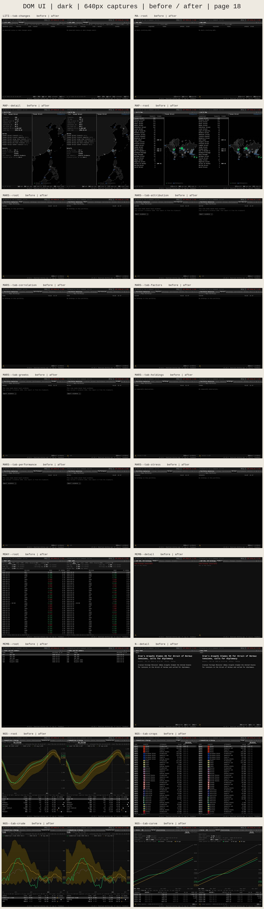

## NGS--tab-markets to OVDV--tab-table

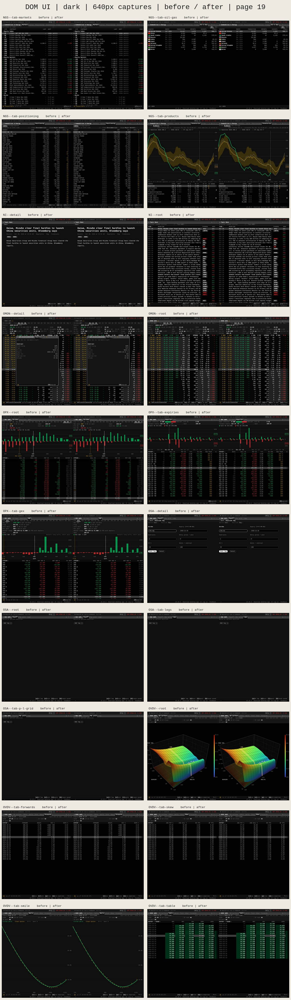

## OVDV--tab-term to PM--tab-climate

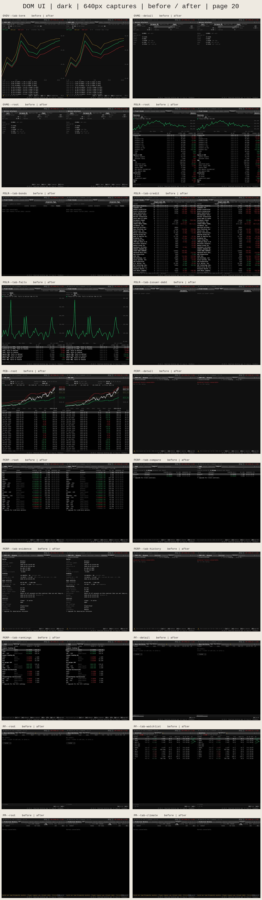

## PM--tab-crypto to POWER--root

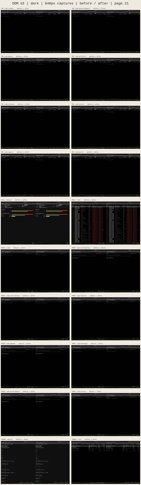

## POWER--tab-capacity to RIPL--detail

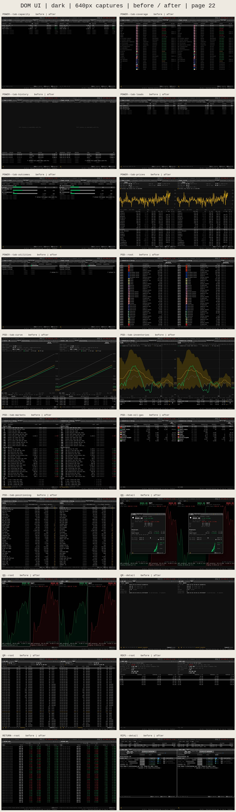

## RIPL--root to SOVR--detail

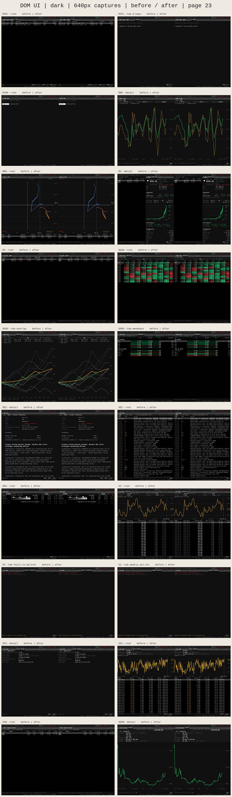

## SOVR--root to T--tab-chart

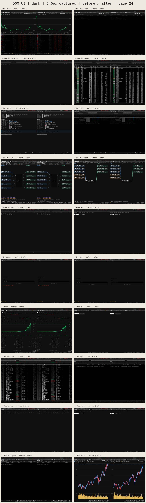

## T--tab-diagnostic to TAS--tab-nbbo

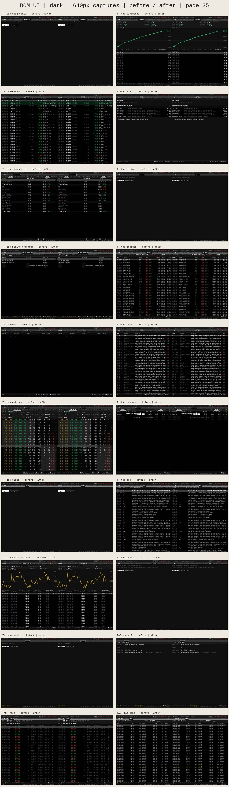

## THEM--detail to VIX--root

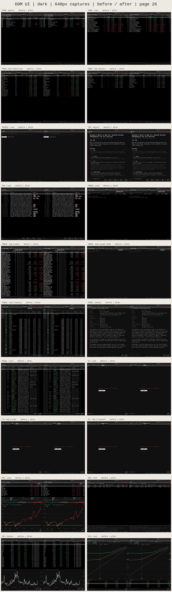

## VIX--tab-cross-asset to new-watchlist-pane--detail

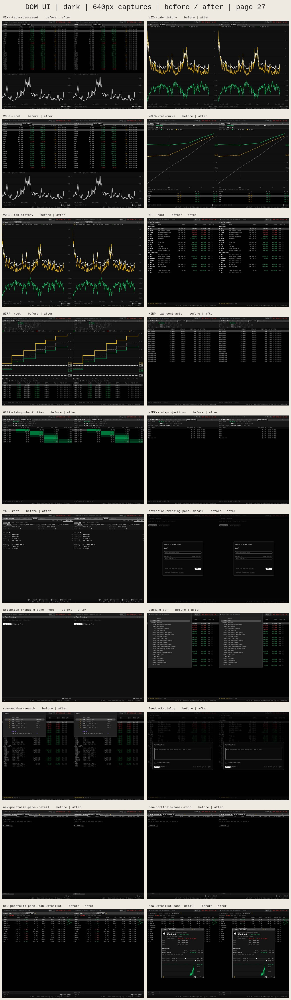

## new-watchlist-pane--root to unread-inbox-pane--root

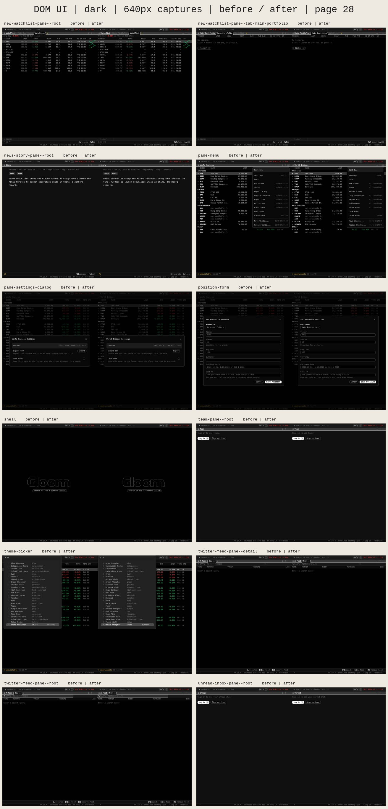
